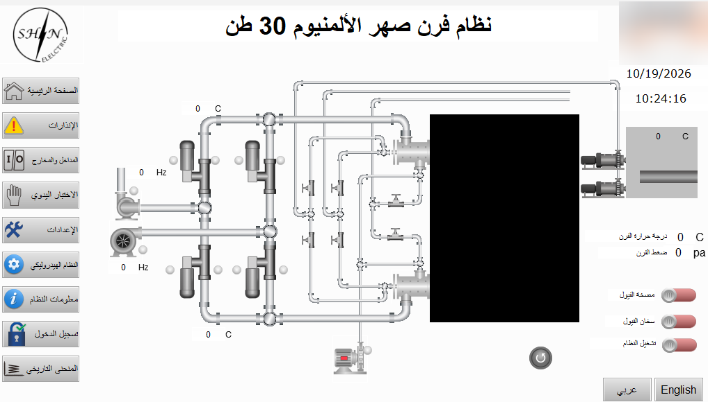
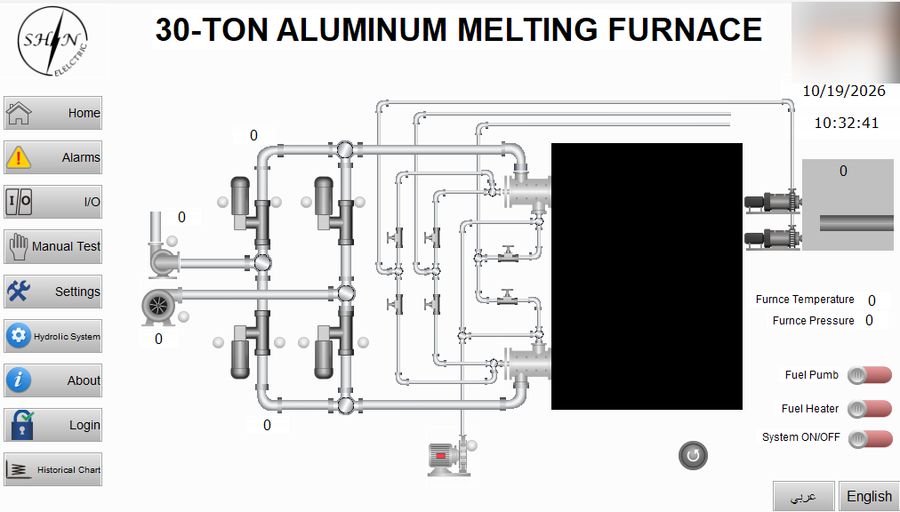
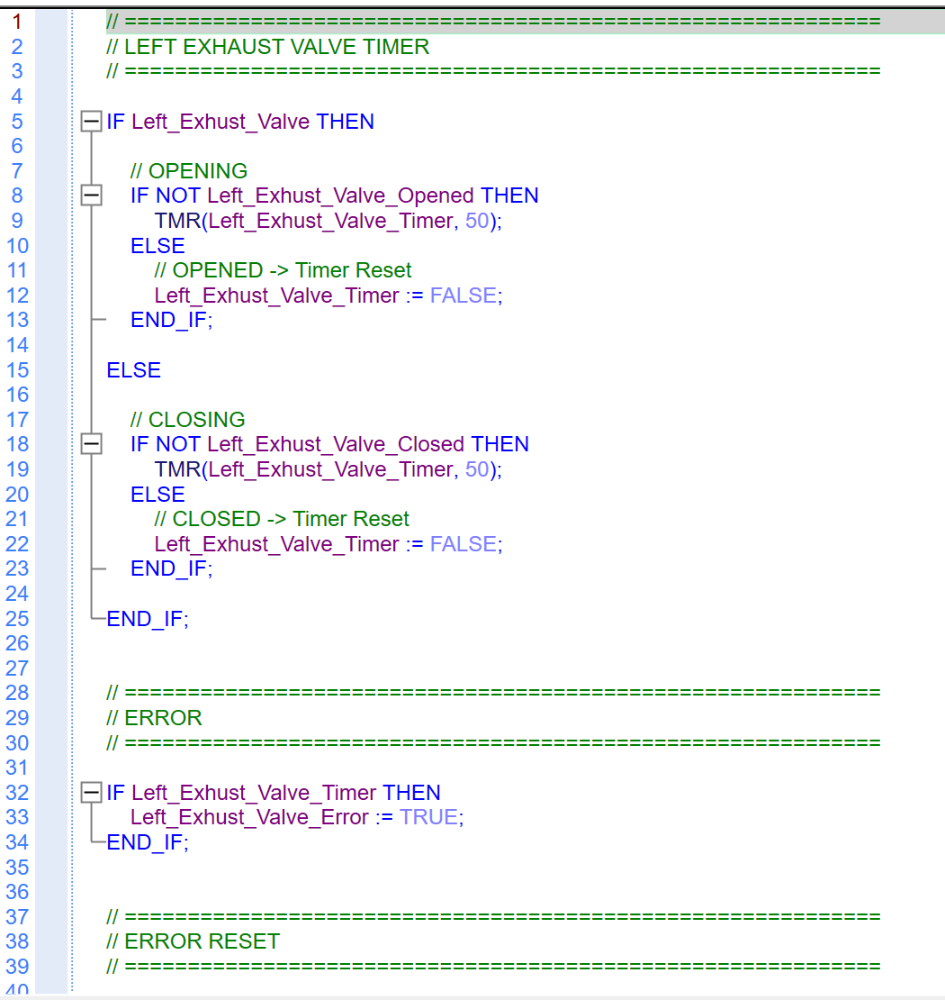

# ⭐ Furnace and Casting Line PLC Replacement

**Tools:** Delta PLC · Delta DIADesigner (PLC programming, Structured Text) · Delta DIAScreen (HMI)

## Hardware

| Part | Model | Qty |
|------|-------|-----|
| PLC | Delta DVP28SV311T | 1 |
| Digital input modules | DVP-16SM | 2 |
| Digital output modules | DVP-16SN | 2 |
| Thermocouple input module | DVP-04TC | 1 |
| Analog I/O module | DVP-06XA | 1 |
| HMI | Delta DOP-110IS | 1 |

## Situation

A grid overvoltage event reached the plant and the panel protections could not react in time. The PLCs of the melting furnace and of the casting line (with robot) were damaged. The manufacturer answered only after a long delay and could not provide the original program files, so restoring the old programs was not possible.

## My role

Rebuilt the control programs for both machines from scratch: machine analysis, I/O mapping, PLC programming, HMI screens, and commissioning.

## What I built

- Corrected several faults that existed in the original logic.
- Designed the program for local grid conditions: frequent power interruptions, with safe recovery after each one.
- Air-cleaning function that clears clogged burner nozzles with compressed air.
- Purge of cold fuel oil from the pipes.
- Trend charts for temperature and pressure.
- Event timeline for operators.
- Fault log that works like a small database of alarms and failures.
- New high-reliability protection devices in the panels against supply overvoltage.
- Operator setpoints and HMI screens on a Delta DOP-110IS.
- **HMI text rewritten:** the original screen had been programmed abroad (China), and its Arabic and English translations were poor and hard for operators to understand. I rewrote all screen texts, alarms and labels in clear Arabic and English so operators can read them correctly.
- **Electrical drawings redone in EPLAN:** I redrew the control panel schematics from scratch in EPLAN following European standards, which makes the panel much easier to read, troubleshoot and maintain.

## Technical challenge

The furnace hydraulic system is driven by a Veichi SD650 servo drive. Its manual had incomplete RS485 information and the manufacturer could not give a correct answer, so I controlled the drive speed with a 0–10 V analog output from the PLC instead. I also had to work out how the hydraulic system operates before I could automate it.

## Electrical design

Full panel schematics (EPLAN, European standards): see [schematics/](schematics/).

## Images

*Additional screenshots: trend chart, event timeline, and fault log.*

### PLC code example: exhaust valve timer

The Structured Text example below starts a timer while the exhaust valve is moving and sets an error if it does not finish within the configured interval.

## Result

| | Before | After |
|---|---|---|
| Furnace stops | 2–3 per day, up to 1 hour each (swap a clogged burner gun, then clean the dirty one) | No unplanned stops for this reason; burner guns opened once a week for preventive cleaning only |

- The furnace restarts safely after a power cut and return.
- Rebuild and commissioning took about 10 days.
- A plant-wide UPS is being installed to protect against unreliable grid power.
